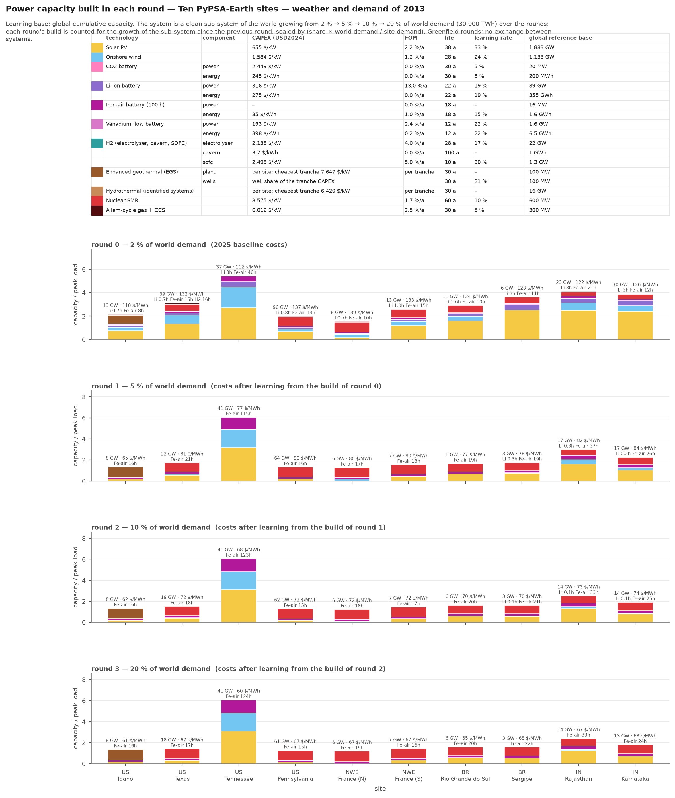
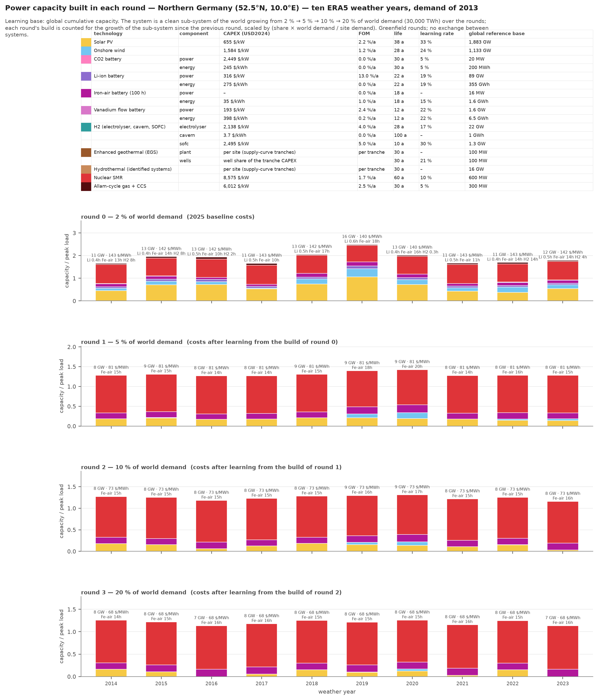

# Isolated-system learning loop: which clean technologies win under current consumption?

Exploratory experiment ahead of the WP3 investment loop. Ten isolated one-node systems each
build a least-cost 100 % clean electricity system for their own hourly demand (PyPSA, 8760 h);
every technology then learns from the capacity *that system* built, the system is
re-optimised at the learned costs, and this repeats for four rounds. Each system is read as
a clean sub-system of the world that grows from 2 % to 5, 10 and 20 % of world electricity
demand over the four rounds; its build counts toward the global experience curve scaled
accordingly, and the learning base is today's global cumulative capacity. EGS geothermal
enters with the site-specific supply curve from [`../geothermal`](../geothermal/README.md)
at Idaho only; hydrogen is stored in salt caverns. The directory name
`pareto/` predates the experiment (it started as a screening-curve idea, see
[Framing](#framing-screening-curves-and-the-ldes-design-space) below); the loop is what
was built.

Two datasets, one figure set each:

* **sites** (geography): the ten mutually uncorrelated PyPSA-Earth buses of
  [`../fourier`](../fourier/README.md) (US, North-West Europe, Brazil, India), 2013 weather
  and their own 2013 demand.
* **years** (weather): the Northern-Germany point (52.5°N, 10.0°E) with ten ERA5 weather
  years 2014–2023 and the same 2013 demand profile (43 TWh/a) in every year — the
  variability shown there is weather only.

## Results (2026-09-26, global base, sub-system growing 2 → 20 % of the world, EGS at Idaho only)

*Figures and `build/` regenerated 2026-10-10 with the current config and the geothermal dataset of that day
(EGS plant fits capped at 250 °C: the cheapest Idaho cell 7,050 → 7,560 $/kW); the numbers in this section are still
those of 2026-09-26.*



*Power capacity built in each of the four rounds at the ten sites, in multiples of the site's
peak load (generators, storage discharge power, SOFC); above each bar the total GW, the LCOE
and the storage energy in hours of peak load; the round title gives the share of world demand
the sub-system represents. The table lists the assumptions behind every colour. Same figure
for the ten weather years: `figures/loop_years.png`; energy shares: `figures/energy_{sites,years}.png`;
the learned capex per round: `figures/capex_{sites,years}.png`. Numbers, incl. `doublings`,
`scale`, `share_of_world` and `built_world` per component and round: `build/loop_{sites,years}.csv`.*



**Who learns.** Counting a sub-system of 2, then 3, 5 and 10 % of world demand, the mature
technologies barely move over four rounds: solar accumulates 0.1–1.3 doublings (655 → 480–650
USD/kW; the 1.3 is Tennessee), onshore wind 0–1.2, Li-ion 0.2–1.0. The first-of-a-kind
technologies still learn massively because their bases are tiny: iron-air reaches 13–16
doublings (35 → 3–5 USD/kWh), the SMR 10 doublings wherever it is built (8,575 → 3,200
USD/kW; a 4 GW fleet in a 40 TWh system is 60 GW world-equivalent in round 0 alone against a
0.6 GW base), EGS wells 13 doublings at Idaho (well cost × 0.06). Allam-cycle gets 1–5
doublings from its small round-0 role and then disappears; VRFB, the CO2 battery and the
hydrogen chain are never built beyond traces and never learn. Li-ion is gone from every
system by round 1, replaced by iron-air at 15–33 h of peak load.

**Sites (geography).** Round 0 is the 2025 picture of the first run (solar + wind + a
0.3–0.8 × peak SMR fleet + iron-air, 112–139 USD/MWh), except Idaho, where the 6,000–7,300
USD/kW EGS tranches already carry 0.8 × peak at 102 USD/MWh. From round 1 the outcome is
decided by the SMR's ten doublings: eight of the ten sites converge to an **SMR-dominated
system** — SMR 0.7–1.0 × peak supplying 74–101 % of energy, iron-air 15–33 h of peak, a
residual solar fleet of 0–1.3 × peak in the sunny sites — at 65–68 USD/MWh in round 3.
Idaho stays **EGS + iron-air** (EGS 0.94 × peak, 103 % of energy, 50 USD/MWh). Tennessee, the
best wind site, is the only **solar + wind + iron-air** system (3.1 + 1.7 × peak, 124 h of
iron-air, 60 USD/MWh); it is also the only site where solar and wind learn more than one
doubling, because it builds five times more of them than an SMR site does.

**Weather years (Northern Germany, same demand).** All ten years converge to the same SMR
system: 0.95 × peak SMR, 14–16 h of iron-air, a 0–0.16 × peak solar remnant; LCOE 142 → 81
→ 73 → 68 USD/MWh with no spread at all (the round-0 spread is 3 USD/MWh). As in the
previous run, the weather-year sensitivity of the first run disappears once a firm
technology wins; here it is the SMR rather than EGS.

**Reading across the three conventions.** The archived "world in miniature" run let solar
and iron-air learn several doublings per round and produced solar + storage everywhere at
21–44 USD/MWh with a factor-two weather-year spread. The archived global-base / one-tenth run
gave EGS wherever the conduction model found hot rock and the SMR elsewhere. This run, with
EGS confined to Idaho and a sub-system growing from 2 to 20 % of the world, gives the SMR
almost everywhere at 65–68 USD/MWh. The common mechanism is Wright's law with a tiny
reference base: whichever firm technology has both a non-trivial rate and a base of a few
hundred MW turns its first sizeable build into ten doublings and locks in from round 1,
whereas solar, wind and Li-ion with terawatt-scale bases cannot learn from a 2–20 % slice of
the world. The interesting counterfactual is therefore not the weather year but the
reference base and rate of the FOAK technologies (a 10 % analogy rate for the SMR is the
whole result), and how much of the world the modelled clean sub-system is allowed to be.

## Method

```
../technology-costs/build/costs_2025_table.csv   USD2024 capex, FOM, lifetime, efficiency, fuel     ─┐
../technology-costs/build/learning_rates.csv     fitted learning rates (cross-check)                 ├─ techs.py ──► one row per component
../technology-costs/data/learning/manual.csv     latest global cumulative capacities (reference base)┘   (capex0, FOM, life, LR, C_ref)
../geothermal/build/egs_potential.csv            EGS cells (USD2024 plant / well CAPEX, FOM, MW)  ─┬─ techs.egs_tranches / hydrothermal_tranche:
../geothermal/build/hydrothermal_sites.csv       identified hydrothermal systems                  ┘   per-site supply-curve tranches within 250 km
../fourier/build/profiles_sites.nc, ../weather-years/build/profiles_years.nc   cf_wind, cf_solar, demand_mw (8760 h, local time); ../fourier/build/sites.csv site coordinates
  └─ run_loop.py (build_network.py) ─►  build/loop/<dataset>/<i>.csv     one row per (round, component)
       └─ collect ─►  build/loop_<dataset>.csv
            └─ plot_loop.py ─►  figures/loop_<dataset>.{png,pdf}     power capacity built per round (stacked, / peak load)
                                figures/energy_<dataset>.{png,pdf}   generation and storage discharge per round (/ annual demand)
                                figures/capex_<dataset>.{png,pdf}    capex applied per round, one line per series
```

Run from this directory with the priam-myopic pixi env (Gurobi licence at `~/gurobi.lic`;
80 solves of ~15–30 s, ~15 min with `-c8`):

```bash
S=../../models/priam-myopic/.pixi/envs/default/bin/snakemake
$S -n        # dry run
$S -c8       # 4 jobs x 2 solver threads
```

Every script also runs standalone: `python techs.py` prints the component table,
`python build_network.py sites 0` solves one round for the first site, `python run_loop.py
years 3` runs the loop for the fourth weather year, `python plot_loop.py sites` redraws.

**The system.** One electricity bus, the site's hourly demand as a fixed load, no imports, no
load shedding, greenfield: every capacity starts at zero and is extendable at its annuitised
cost (7 % real discount rate, lifetimes from the cost table, FOM as a fraction of capex).
Solar and onshore wind use the site's capacity factors; SMR and Allam-cycle have a flat 90 %
availability and their fuel cost (uranium 8.2, gas 47.2 USD/MWh_th, no CO2 price: Allam
counts as clean at 97 % capture). **Geothermal is site-specific and restricted to Idaho**
(`geothermal.sites`): the EGS cells of `../geothermal/build/egs_potential.csv` within 250 km
of the site (about the size of a clustered PyPSA-Earth bus region) are binned by CAPEX into
supply-curve tranches (< 6,000, 6–8,000, 8–10,000, 10–12,000, 12–15,000, 15–20,000 USD/kW;
dearer cells dropped), each a capped generator at the capacity-weighted plant + well CAPEX and
FOM of its cells, 90 % capacity factor, 30 years — at Idaho 2 GW at 6,000 and 129 GW at
7,300 USD/kW; the identified hydrothermal systems within the radius form one more capped
generator at the ATB 2025 cost (124 MW). The other nine sites and Northern Germany get no
geothermal: their cheap cells (France 7,300, Sergipe 7,400, Northern Germany 7,900 USD/kW)
come from the 0.25° conduction temperature model outside CONUS, which is not trusted enough
to put a first-of-a-kind EGS there; Texas, Tennessee, Pennsylvania and India have nothing
below 9,000–15,000 USD/kW anyway. Batteries are a Store plus charger / discharger Links with
equal power, round-trip losses on the charger and the power cost on the discharger
(delivered MW); Li-ion, VRFB and the CO2 battery size energy and power independently,
iron-air is Form's fixed 100 h product priced per kWh only. Hydrogen is an electrolyser Link
(58.7 %), a **salt-cavern** Store (DEA 151c: 3.3 EUR2025 = 3.68 USD2024/kWh_H2, no FOM,
100 years — twenty times cheaper than the tank of the first run, but geology-bound; applied at
every site here) and a SOFC Link (59 %, priced per kW_el out) on an H2 bus. Geothermal, large nuclear, offshore wind, hydro and unabated gas are outside the
palette on purpose (the latest cost deck plus the mature trio solar / onshore wind / Li-ion).

**Learning (global base, a growing clean sub-system).** Each component has a 2025 capex
`capex0`, a learning rate `LR` and a global reference cumulative capacity `C_ref` — the
capacity at which the 2025 cost is quoted in the technology-costs learning data, floored by
one indivisible unit where that is larger (only Allam: 300 MW). The optimised system is read
as a clean sub-system of the world that grows over the rounds: in round *k* it represents a
share `σ_k` of world electricity demand (2024: 30,000 TWh), `σ = 2, 5, 10, 20 %`. Because
every round is a greenfield optimisation, the build of round *k* is counted for the *growth*
of the sub-system, `Δσ_k = σ_k − σ_{k−1}` (2, 3, 5, 10 %), scaled by
`s_k = Δσ_k · 30,000 TWh / L` with `L` the site's annual demand (Idaho: × 15, 23, 38, 76 in
rounds 0–3; Pennsylvania × 1.8 … 9; Sergipe × 57 … 283); `learning_base.counting: full`
would count each round's whole fleet at `σ_k` instead. After round *k* Wright's law sets the
next round's capex,

    capex_{k+1} = capex0 · ((C_ref + Σ_{j≤k} s_j · built_j) / C_ref) ^ log2(1 − LR),

FOM scales with capex, fuel does not. Learning is local (no exchange between the ten
systems) and per component: Li-ion energy and power, the electrolyser and the SOFC learn on
their own curves. EGS learns on the **well** part of each tranche's CAPEX only (drilling,
stimulation, exploration: 50–79 % of CAPEX in the Ricks & Jenkins model), at the 21 %
first-difference rate of the Fervo well series against a 0.1 GW global base; the surface
plant and the FOM do not learn. `doublings`, `scale`, `share_of_world` and `built_world`
per component and round are in the output tables. The values are printed as the legend
table on top of every figure. Two earlier conventions are archived: the global base scaled
*down* to the site's share of world demand (`config.world-in-miniature.yaml`,
`figures/archive-world-in-miniature/`) and a fixed one-tenth-of-the-world share with EGS
tranches at every site (`figures/archive-global-tenth-egs-everywhere/`).

| technology | component | capex (USD2024) | LR | source of the rate | global reference base |
|---|---|---|---|---|---|
| Solar PV | plant | 655 /kW | 33 % | level fit, IRENA 2010–2024 | 1,883 GW (IRENA, all PV, end 2024) |
| Onshore wind | plant | 1,584 /kW | 24 % | level fit, IRENA 2010–2024 | 1,133 GW (IRENA, all wind, end 2024) |
| Li-ion | power / energy | 316 /kW / 275 /kWh | 19 % / 19 % | level fit of BNEF turnkey (energy); power assumed equal | 89 GW / 355 GWh (BNEF end 2024) |
| VRFB | power / energy | 193 /kW / 398 /kWh | 22 % / 22 % | level fit Schmidt 2018 + China 2022–25 (energy); applied to power | 1.6 GW / 6.5 GWh |
| CO2 battery | power / energy | 2,449 /kW / 245 /kWh | 5 % / 5 % | analogy: mechanical storage (deck) | 0.02 GW / 0.2 GWh (one Energy Dome plant) |
| Iron-air (100 h) | energy | 34.8 /kWh | 15 % | analogy: DOE LDES Liftoff 12–18 % (deck) | 1.65 GWh (Form deliveries) |
| H2 | electrolyser / salt cavern / SOFC | 2,138 /kW / 3.68 /kWh_H2 / 2,495 /kW | 17 % / 0 % / 30 % | level fits (Schmidt + IEA GHR 2025; Bloom 10-K) | 21.8 GW / – / 1.3 GW |
| EGS (Idaho only) | wells / plant | tranches: 6,000 (2 GW), 7,300 (129 GW), 9,100 … /kW; plant 2,100–3,300 + wells 3,900–12,100 | 21 % / 0 % | first-difference fit of the Fervo well series (deck: level fit 34 %) | 0.1 GW (Cape Station phase 1, Project Red, FORGE) |
| Hydrothermal (Idaho only) | plant | 6,420 /kW, 124 MW identified (ATB 2025 binary) | 0 % | mature | 15.6 GW |
| Nuclear SMR | plant | 8,575 /kW | 10 % | analogy: scenario value (deck) | 0.6 GW, floor one 300 MW unit |
| Allam-cycle CCS | plant | 6,012 /kW | 5 % | analogy: capture units 2–7 % (deck) | 0.3 GW, floor one 300 MW unit |

## Caveats

* **The learning base decides who learns.** With the global base and a sub-system of 2 %
  of the world in round 0, solar, wind and Li-ion move by a small fraction of a doubling per
  round (a 4 GW solar build at Idaho is 60 GW world-equivalent against 1,883 GW installed),
  whereas the first-of-a-kind technologies still see many doublings (5 GW of EGS at Idaho is
  70 GW world-equivalent against a 0.1 GW base; 40 GWh of iron-air is 600 GWh against 1.65
  GWh). Their capex therefore collapses within one or two rounds to the floor the learning
  curve implies. That is a property of Wright's law with a tiny base, not a forecast; the
  earlier conventions are archived for comparison.
* **Counting the growth, not the fleet.** Greenfield rounds mean the round-*k* fleet contains
  the round-(*k*−1) fleet in spirit, so only the increment of the share is counted; counting
  the full share each round (`counting: full`) would add up to 37 % of the world instead of
  20 %.
* **EGS supply curves are screening-grade** (Stanford temperatures over CONUS, Ricks &
  Jenkins costs, 20 % land derating, no grid connection) and the 250 km radius is a
  convention; the cheap Idaho cells sit in the Snake River Plain / Basin and Range. EGS is
  switched off everywhere else by assumption, not by the data.
* **Salt caverns everywhere** is optimistic where there is no salt (India, most of Brazil,
  Idaho); the hydrogen chain's other costs keep it out of the solution anyway.
* **Greenfield rounds.** Nothing is carried over, so the loop shows the least-cost mix *at
  the learned costs*, not a build-out path; capacity built in round 0 is counted again
  as learning-relevant deployment in later rounds only through its cost effect.
* **Level-fit rates for solar and wind (33 %, 24 %)** are the steep 2010–2024 IRENA fits;
  the Way first-difference estimates are 29 % and 24 %, priam-myopic uses 20 % and 10 %.
  The CO2-battery, SMR and Allam rates are assumptions by analogy.
* **Missing FOM** for the CO2-battery power part and the iron-air power part is set to zero
  (cost table has none). The SOFC stack has a 10-year life, so its annuity is high. EGS FOM
  is the cell's absolute O&M and does not learn.
* **Single 2013 demand profile**, hourly, no demand growth, no transmission, no existing
  capacity, no policy, no CO2 price: a stylised clean-slate system per site.
* The `sites` demand profiles are PyPSA-Earth clustered-bus loads (screening-grade, see
  `../fourier/README.md`); the Northern-Germany point uses the DE0 4 bus profile.

## Framing: screening curves and the LDES design space

The experiment started from a different question — plot, for a 1 MW demand block that must
be met *h* hours a year (1 … 8760, log axis), the least-cost clean technology and its cost
— and from the worry that the metrics of Sepulveda, Jenkins, Edington, Mallapragada &
Lester, "The design space for long-duration energy storage in decarbonized power systems",
*Nature Energy* 6 (2021) 506–516 (`lit/design space for ldes.pdf`) are weather-dependent.
Notes from that discussion, kept here because they frame this loop too:

* **Vocabulary.** The block's *h* is its **full-load hours** (capacity factor h/8760); cost
  per MWh against utilisation is a **screening curve** (Turvey 1968; Stoft, *Power System
  Economics*, 2002), its lower envelope the **least-cost envelope**, and the graphical
  "screening curves × load duration curve → capacity mix" construction the
  **screening-curve method**. It is not a Pareto front (one objective). The demand time
  series sorted descending is the **load duration curve (LDC)**; a weather year is one
  **realisation** of it (**inter-annual variability**: Pfenninger 2017 *Appl. Energy*;
  Collins et al. 2018 *Joule*; Zeyringer et al. 2018 *Nat. Energy*; Ruhnau & Qvist 2022
  *ERL*). "LCOE of meeting a block" is a **levelised cost of firm / delivered electricity**
  (Idel 2022 *Energy*, "LFSCOE"; Perez et al. 2019 *Solar Energy*, "firm LCOE"; Ziegler et
  al. 2019 *Joule*; Tom Brown's model.energy baseload tool). Storage lives in the
  **cycles-per-year × discharge-duration** plane (Schmidt et al. 2019 *Joule*; Albertus,
  Manser & Litzelman 2020 *Joule*); Sepulveda et al. speak of the **energy-to-power ratio**
  and the **marginal increment** of capacity that cycles < 10 times a year.
* **Why a 1-D duration axis cannot abstract from weather.** The screening-curve method is
  exact only for dispatchable plants, because only then does the cost of a block depend on
  *how many* hours and not on *which* hours. With wind, solar and storage, 100 hours as 100
  evening peaks (Li-ion) and 100 hours as one January block (LDES or firm) cost very
  different amounts, and slices solved separately cannot share a wind fleet or a store, so
  the integral of any such frontier over an LDC is only an upper bound on the true optimum.
  This is the known failure that led to **residual load duration curves** (Ueckerdt et al.
  2015 *Energy*), **system LCOE / integration costs** (Ueckerdt, Hirth, Luderer & Edenhofer
  2013 *Energy*; Hirth, Ueckerdt & Edenhofer 2015 *Renew. Energy*; Joskow 2011 *AER*) and
  chronological models. Weather dependence can be *measured* (spread across block
  conventions and years), not removed by construction — which is what the `years` dataset
  of this loop does for the winner-takes-all question.
* **Sepulveda et al. 2021, read critically.** Strengths: a technology-agnostic
  five-parameter design space (charge / discharge power cost, energy cost, charge /
  discharge efficiency), 1,280 combinations in two systems (ISO-NE-like, ERCOT-like) with
  three firm alternatives, clear thresholds (energy capacity ≤ 20 USD/kWh for ≥ 10 % system
  cost reduction, ≤ 1–10 USD/kWh to displace firm generation), a proper duration definition
  (E·η⁻/P_d, optimal durations 100–650 h) and the observation that the marginal LDES
  increment cycles fewer than ten times a year. Weaknesses for our purpose: one base weather
  year per system, two alternative years for the Northern system only, so the "LDES hedges
  bad years" claim rests on two points; the ranking "energy cost > discharge efficiency >
  power cost" comes from min–max-normalised regression coefficients, i.e. it compares the
  ranges the authors chose (1–50 USD/kWh spans ×50, power cost ×9) and the linear model has
  R² 0.66 on a threshold-shaped response; no self-discharge or degradation, 7.1 % *nominal*
  WACC over 30 years, isolated systems without transmission, an E/P cap of 1000 that binds
  in 60 cases; and system value is reported relative to a firm-only reference whose cost
  depends on ATB-2018 nuclear / CCS assumptions. The optimal duration and the value of LDES
  are properties of how long and how often the residual load is in deficit — i.e. of the
  weather year — which is the concern that motivated this directory.
* **Other useful literature.** Sepulveda et al. 2018 *Joule* (firm low-carbon resources);
  Dowling et al. 2020 *Joule* (39 weather years, LDES role); Shaner et al. 2018 *EES* and
  Tong et al. 2021 *Nat. Commun.* (geophysical reliability limits of wind + solar over many
  years and countries); Mallapragada, Sepulveda & Jenkins 2020 *Appl. Energy* (capacity
  substitution value of storage); Denholm & Mai 2019 *Renew. Energy* (storage timescales
  vs curtailment); Grochowicz et al. 2023 *Energy Econ.* (near-optimal spaces robust to
  weather years); Kittel & Schill 2024 (measuring Dunkelflaute); Heptonstall & Gross 2021
  *Nat. Energy* (integration-cost review); Brown & Reichenberg 2021 *Energy Econ.* (market
  value of VRE); Riepin, Jenkins, Swezey & Brown 2025 *Joule* (the 24/7 CFE study this
  project generalises, whose cost-vs-CFE-score curve *is* a trade-off curve).
