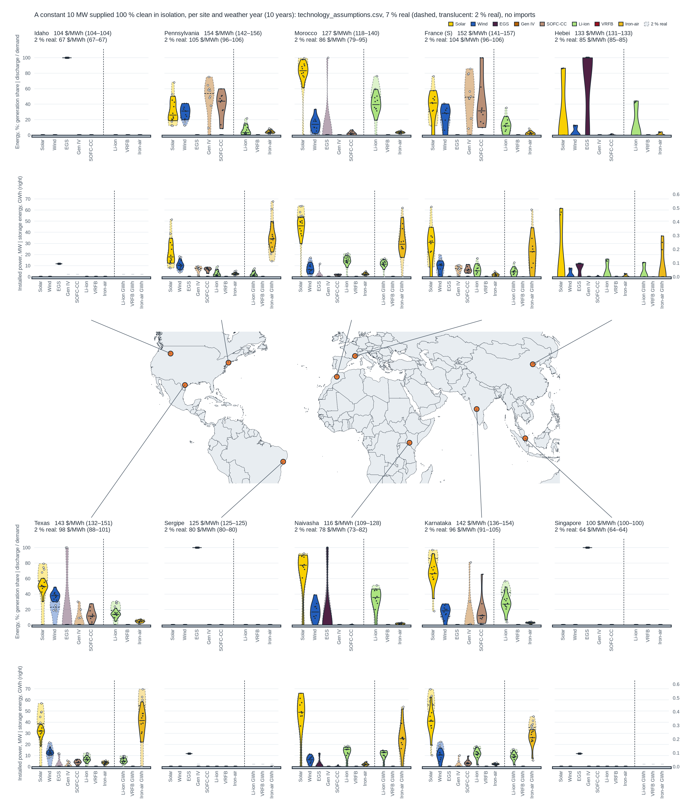

# Toy model of clean procurement: what the technology assumptions imply, site by site, weather year by weather year

A quick, repeatable projection of what the project's techno-economic input
([`technology_assumptions.csv`](../../config-pypsa-earth/technology-assumptions/technology_assumptions.csv))
implies when a buyer has to be supplied 100 % clean on its own: **a constant 10 MW of demand** (87.6 GWh/a, the
24/7 buyer's flat profile) at each of the ten sites of [`../weather-years`](../weather-years/README.md), for
each ERA5 weather year 2014–2023, one greenfield one-node PyPSA capacity expansion with hourly resolution, and
a figure that shows the energy mix (shares) and the installed capacities (MW, storage energy in GWh) per site
as violins over the weather years. Every number comes from the CSV; change a number there and `snakemake`
reruns the optimisations and the figure.



## What the current CSV implies (run of 2026-10-14, all ten weather years 2014–2023, constant 10 MW, procurable resources, no LWR, no hydrothermal)

Two mature rows are out of the palette since 2026-10-08 because they cannot carry the catalytic effect the
project is about: **LWR nuclear** (`learning_rate` 0 in the CSV; with it in it took 100 % at Texas,
Pennsylvania, Hebei and Karnataka, 130 $/MWh outside China / India and 59 inside, and 20 % at Morocco;
`build/results_with_lwr.csv`) and **conventional hydrothermal** (the assumptions document applies no learning
and builds no new conventional geothermal by default, because the reservoirs are few, site-specific and slow
to develop; the CSV's 7 GW pipeline is those known reservoirs being developed anyway; with it in it took 100 %
at Naivasha, 66 $/MWh, and Idaho, 97; `build/results_with_hydrothermal.csv`). Both variants are from the
three-year dataset and the geothermal data before 2026-10-10. What remains is the advanced palette plus solar,
wind and Li-ion. Shares below are medians over the ten years with the range in brackets, in % of demand.

- **EGS sites are single-plant**: 11.8 MW of EGS in every weather year at Singapore (100 $/MWh, cheapest cells
  7,280 $/kW), Idaho (104, 7,650 $/kW) and Sergipe (125, 9,240 $/kW), and at Hebei (131–133, 9,890 $/kW) in 7 of
  10 years; in the other three Hebei flips to solar plus Li-ion at almost the same cost. A firm plant sized for
  the night supplies the day at zero fuel cost, which solar cannot undercut, so the choice is all or nothing.
  (Since 2026-10-10 the geothermal dataset caps the plant fits at 250 °C and uses the Limberger temperature
  model over Europe; France (S) lost its EGS this way, its cheapest cell going from 7,650 to 14,450 $/kW.)
- **The others are renewables-plus-storage systems with SOFC-CC as the backstop**, and here the weather year
  matters: Morocco solar 90 (66–104), wind 15 (3–36), Li-ion cycling 40, SOFC-CC 2 (0–8), 118–140 $/MWh;
  Naivasha solar 80, wind 18, Li-ion 36, no SOFC-CC, 109–128 $/MWh, with EGS (9,520 $/kW) taking over in one
  year; Karnataka solar 70 (35–99), wind 20, SOFC-CC 13 (2–66), 136–154 $/MWh; Texas solar 54, wind 41,
  SOFC-CC 13 (1–29), 132–151 $/MWh; France (S) solar 45, wind 30, SOFC-CC 33 (11–100), 141–157 $/MWh;
  Pennsylvania wind 33, solar 28, SOFC-CC 47 (9–62), 142–156 $/MWh. Iron-air discharges 2–5 % of demand
  everywhere it is built and sizes 0.2–0.5 GWh. Gen IV (17,000 $/kW, 198 $/MWh) and VRFB are never built.

**At a 2 % real discount rate** (config `variants`, drawn as the translucent dashed violins,
`build/results-discount-2pct.csv`) every site is 30–40 % cheaper (Singapore 64, Idaho 67, Sergipe 80, Hebei
85, Morocco 79–95, Texas 88–101, Pennsylvania 96–106, France (S) 96–106 $/MWh), SOFC-CC drops out everywhere
(its fuel is not discounted) and the capital-heavy firm options come back. Gen IV takes the firm role at
Pennsylvania (median 57 %) and France (S) (median 50 %), and in single years at Karnataka and Texas. Hebei is
EGS in all ten years. Morocco, Texas and Naivasha sit on the tie between EGS and solar plus storage and flip to
100 % EGS in one or two weather years; their wide EGS violins span 0 and 100 %, not intermediate shares.

The earlier variants are kept in `build/`: `results_with_lwr.csv`, `results_with_hydrothermal.csv`,
`results_local_resource.csv` (bus-average resources, bus-shaped demand, per MWh) and `results_free_dispatch.csv`
(that one without the nuclear minimum load). `demand.kind: bus` keeps the site's 2013 load shape at a 10 MW
mean instead of the flat load. The weather years grow as `../weather-years/fetch_and_rebuild.sh` fetches them
(three per site in the first stage); the figure updates automatically after each fetch stage.

## Method

**The system.** One bus, a constant 10 MW load (config `demand`; `kind: bus` instead uses the site bus's
2013 load shape at a 10 MW mean), no imports, no load shedding, no existing capacity, no CO₂ price: every
technology is built from zero at the annualised cost of the CSV (7 % real discount rate, the LCOE convention
of the assumptions document; `capital_cost = capex × annuity(7 %, lifetime) + FOM`, `marginal_cost = VOM +
fuel / efficiency`). The geothermal supply-curve caps are the real GW of the cells within 250 km, which a
10 MW buyer never exhausts, so EGS enters at its cheapest tranche. Solver: Gurobi barrier, one problem of
8760 h per site and weather year, a few seconds each.

**The palette** (`config.yaml` `palette`; `techs.py` refuses to run if a CSV row is in neither `palette` nor
`excluded`, so a new row has to be placed on purpose):

| CSV row(s) | in the model | what varies by site |
|---|---|---|
| `solar-utility`, `onwind` | generator with the weather year's hourly capacity factor | the weather |
| `egs` | one capped generator per CAPEX tranche of the EGS cells within 250 km of the site (`../geothermal/build/egs_potential.csv`: CAPEX, FOM, CF 0.85, 30 a per cell; bins 6–8, 8–10, 10–12, 12–15, 15–20 k$/kW; `../pareto/techs.py::egs_tranches`); the CSV row is the Cape Station reference | the supply curve: cheapest cell Singapore 6,430 (conduction model over Sumatra, see caveats), Idaho 7,560, Sergipe 8,780, Kenya 8,940, Hebei 9,800, Morocco 10,250, Texas 11,900, France S 13,440 (Limberger model), Pennsylvania 15,800, Karnataka 18,500 $/kW (2026-10-10, 250 °C cap) |
| `nuclear-gen4`, `sofc-cc` | firm generators at CF 0.9 with fuel and VOM from the CSV (SOFC with capture counts as clean here, decided 2026-10-07) | — |
| `battery-liion`, `vrfb` | Store + charger / discharger links, power and energy sized freely; FOM split between power and energy at the CSV's reference duration; VRFB efficiency 0.806 read as per direction (round trip 0.65, the CSV README's caveat) | — |
| `iron-air` | the same with energy = 100 h × power (`duration_h`) | — |
| `offwind` | **excluded**: no site profile; the document's offshore convention (onshore CF over shallow sea) would only clone onwind at a higher cost | |
| `hydro`, `ror`, `PHS` | **excluded**: existing fleet only in the study, nothing to build greenfield | |
| `biomass` | **excluded**: no site-level feedstock potential, unlimited biomass would be a cheap firm resource everywhere (decided 2026-10-07) | |
| `geothermal` | **excluded** (decided 2026-10-08): conventional hydrothermal is mature, no learning, and the assumptions document builds no new conventional geothermal by default; not a catalytic candidate. `techs.py::hydrothermal_tranche` (identified systems within 250 km, operating plants excluded; Kenya 1.7 GW announced / pre-construction, Idaho 124 MW of USGS systems) is kept and the config comment shows the entry that puts it back | |
| `nuclear-lwr-cnin`, `nuclear-lwr-row` | **excluded** (decided 2026-10-08): mature with `learning_rate` 0, so no catalytic effect to project; the config comment shows the one-line palette entry that puts it back (3,150 $/kW in China / India, 11,000 elsewhere, bin by site country) | |
| `CCGT`, `OCGT`, `sofc` | **excluded**: unabated fossil | |
| `co2-battery` | **excluded**: `in_default_mix = no` (VRFB is in on request) | |

**The figure.** A 4 × 5 grid of axes around the sites' map: five sites above the map (the northernmost
five), five below, each site a column of two axes tied to its marker by a short straight connector (column
order per band chosen over all permutations: no crossings, then the shortest lines). Row "Energy": one violin
per generation technology (share of the generation delivered to the bus, %), a dashed separator, one violin
per storage technology (energy discharged, % of annual demand). Row "Capacity": installed power in MW for every
technology, generators and storage discharge power alike, the separator, then the storage energy capacities in
GWh on the right-hand scale. Each violin spans the ten weather years (ink dots =
the years, ink tick = the median); "–" marks a technology never built at that site. The column title carries
the median and range of the system LCOE. Colours are the PyPSA-Eur default `tech_colors` (solar, onwind,
nuclear, li-ion, iron-air, vanadium verbatim; EGS from its geothermal entry, SOFC-CC from
`allam`, Gen IV a darkened nuclear), the rest of the look is the repo's icon plot style.

**Dispatch of the firm plants.** Firm technologies dispatch between `min_load` × capacity and the CSV
capacity factor (0.9) at their marginal cost (fuel / efficiency + VOM). Nuclear (Gen IV) carries
`min_load: 0.5` (decided 2026-10-07): a minimum stable output of 50 %, between France's routine 30–100 %
load following and the 50–100 % band of the fleet-wide operating experience (SNETP factsheet 7), and the
usual choice of unit-commitment capacity-expansion studies. When LWR was still in the palette it changed
little: the optimiser kept the cheap Chinese / Indian LWR cycling between 50 and 90 % of capacity around
midday solar (Hebei capacity factor 0.61 with the minimum, 0.59 without; Karnataka 0.74; the US sites
0.77–0.78), the "flexible base" mode of Sepulveda et al. 2018, and system costs moved by under 1 %. The
free-dispatch variant is kept in `build/results_free_dispatch.csv` / `summary_free_dispatch.csv`. SOFC-CC
stays free (fuel cells modulate). Ramp limits (5 %/min) do not bind at hourly resolution. "Firm" in the Sepulveda et al. 2018 sense means available on demand in all
seasons, not baseload.

## How to run

```
Snakefile
  ├─ run      run_site_year.py (build_network.py, techs.py)  ─►  build/runs/<site>/<year>.csv   one row per technology
  ├─ collect                                                 ─►  build/results.csv
  └─ plot     plot_overview.py                               ─►  figures/overview.{png,pdf}, build/summary.csv
```
```bash
../../models/priam-myopic/.pixi/envs/default/bin/snakemake -c8     # from this directory; ~5 min; Gurobi licence at ~/gurobi.lic
```
`variants` in the config lists extra cases run beside the base case (keys override top-level config keys, e.g.
`discount_rate: 0.02`): `build/runs-<variant>/`, `build/results-<variant>.csv`, overlaid in the figure as
translucent violins with a dashed outline and hollow dots (a dashed line where the variant collapses to one
value) and a second LCOE line in each column title; `build/summary.csv` carries a `variant` column.

Inputs: `../weather-years/build/profiles_siteyears.nc` (build it first), `../geothermal/build/*.csv` and the
assumptions CSV, all declared as Snakemake inputs so a change reruns what depends on it. Standalone:
`python build_network.py ke-naivasha 2019` prints one run; `python techs.py` prints the technology table
for a US and an Indian site and the EGS tranches at Idaho and Naivasha.

Per-run CSV columns: `key, site, year, tech, row` (the CSV row used), `label, group, kind, model,
capex_power_used, capex_energy_used` (for tranches: the USD/MW/a actually paid, averaged over the built
tranches), `p_nom_mw` (generators; the discharger for storage), `e_nom_mwh, energy_mwh` (delivered to the
bus), `energy_in_mwh, curtailed_mwh, fixed_cost, var_cost, tranches, system_cost, demand_mwh, peak_mw,
lcoe_usd_mwh`. `build/summary.csv`: median / min / max over the weather years of the three plotted
quantities (`energy_pct`, `p_nom_mw`, `e_nom_gwh`) per site and technology. The number of weather years grows
while `../weather-years/fetch_and_rebuild.sh` fetches them breadth-first (three per location per stage); the
Snakefile takes the years from the dataset.

## Caveats

- Demand has the same shape in every weather year (no temperature coupling): the violins show weather
  variability of supply only.
- EGS outside the continental US and Europe comes from the smooth Lucazeau conduction model (`t_source` in
  `egs_potential.csv`), which is why Singapore sees 6,430 $/kW cells (Sumatra's volcanic arc within 250 km):
  treat cheap EGS outside the US and Europe as indicative. The nine-cell weather stencil stands in for whole cluster regions
  or countries (Morocco, Kenya, Singapore are one-node countries in PyPSA-Earth).
- Wind and solar profiles are the site's *procurable* resource (the best bus of its own grid, or a documented
  resource point for the one-node countries, see `../weather-years/README.md`), not the cluster-average
  resource at the load bus; transmission between the two is not costed. The first run of 2026-10-07 used
  the bus-average profiles (kept as `build/results_local_resource.csv`), under which LWR at 11,000 $/kW took
  80–90 % at Texas and Pennsylvania because their local wind sat at 0.20–0.28 against 0.35 in the grid.
- No offshore wind, no hydro, no biomass, no transmission to neighbours: an isolated clean slate, not a
  forecast. 100 % clean admits SOFC with capture (≈ 10 % residual emissions).
- Storage FOM is split between power and energy at the CSV's reference duration; the CSV gives one FOM per
  kW at that duration.
